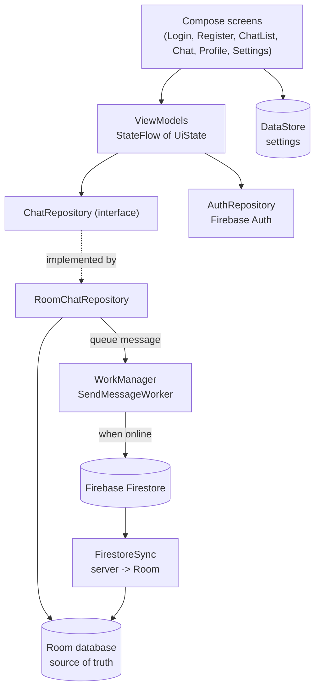
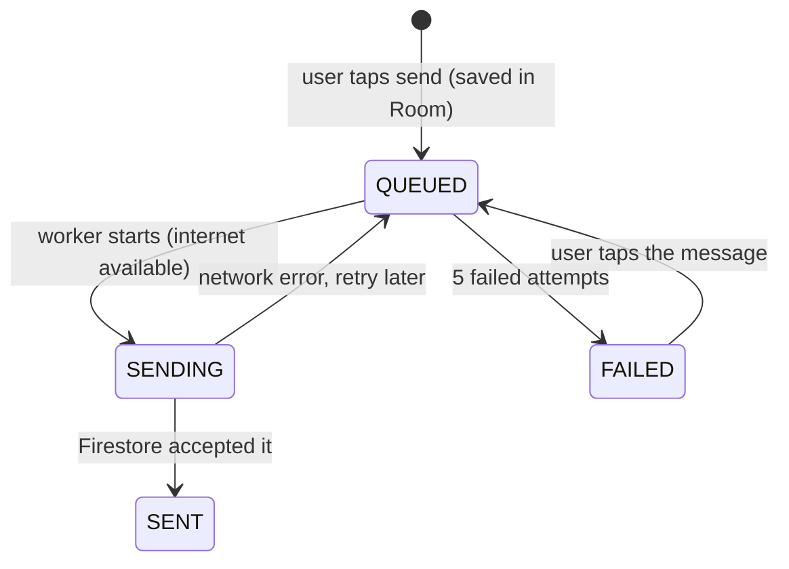

# Architecture

## Message life cycle

## Rules the code follows
1. Screens only know `ChatRepository`, never Room or Firestore directly.
2. Room is the single source of truth; the UI only reads Room.
3. Every write goes to Room first, then to the server in the background.
4. State flows down (ViewModel -> screen), events flow up (screen -> ViewModel).
