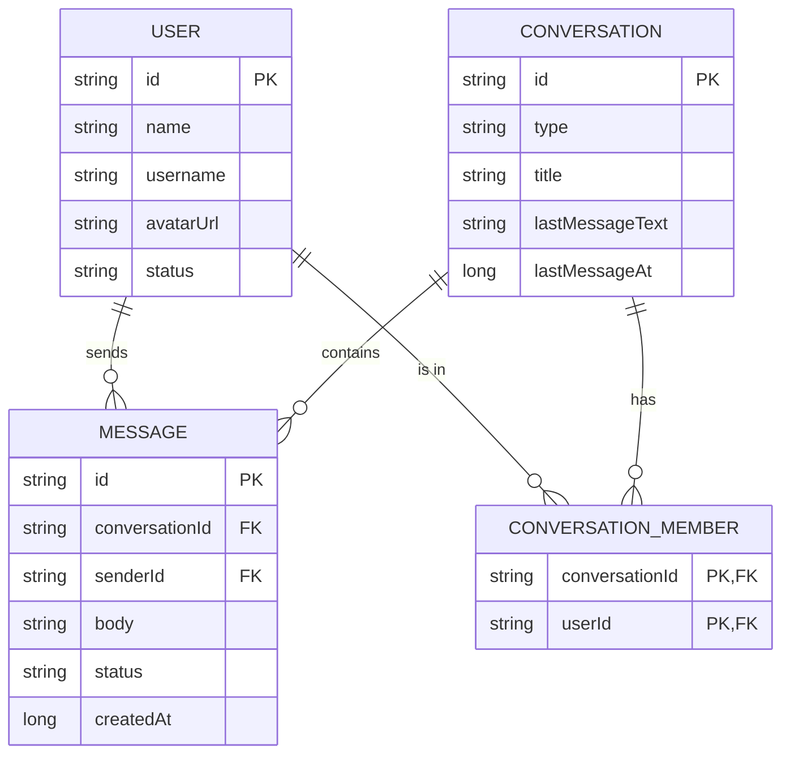

# Data model

Firestore is shared in the cloud. Room is the local copy that the UI reads.

## Firestore structure
- `users/{uid}`
- `conversations/{conversationId}`: direct chats use the sorted user IDs joined by `_`; groups use a random ID
- `conversations/{conversationId}/messages/{messageId}`: the ID is created on the phone (retry-safe)

## Rules
- The UI reads only from Room; the repository syncs Firestore into Room.
- Message status: QUEUED, SENDING, SENT, DELIVERED, READ, FAILED.