# Wireframes

Wireframes of every screen in La Familia, drawn from the labels, components and
layout used in the app (`app/src/main/java/com/lafamilia/app/ui/`).

Colors are the app's own Material 3 theme (`ui/theme/Color.kt`, `ui/theme/Theme.kt`):
terracotta primary (`#B4492F` light / `#FFB4A1` dark), its container tone for your own
message bubbles, avatars and the + button, and the warm background (`#FFF8F6` light /
`#1A110F` dark). Roles the theme does not override use the Material 3 defaults.

## Navigation graph

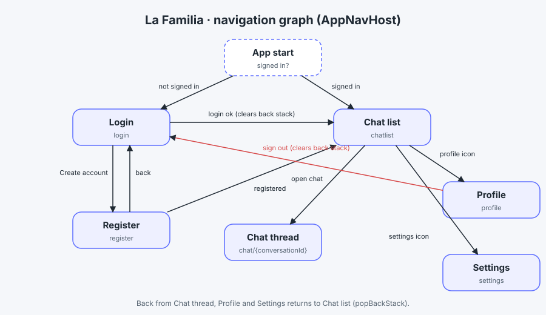

The same graph as text (it matches `navigation/AppNavHost.kt`):

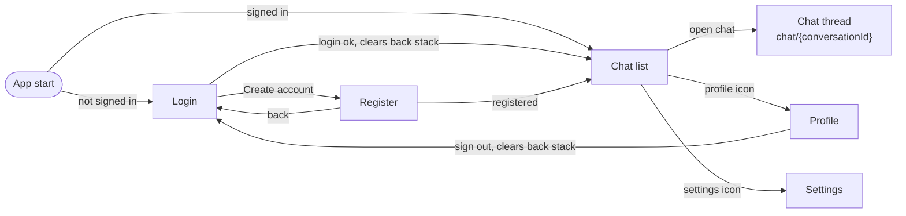

Back from Chat thread, Profile and Settings returns to the Chat list (`popBackStack`).

## Screens

| | | |
|---|---|---|
| 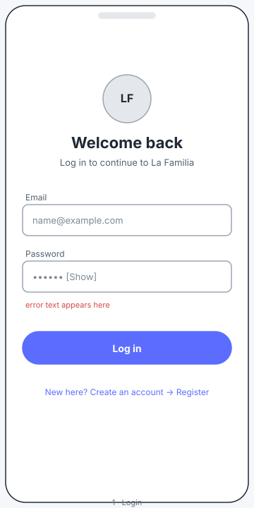 **1. Login**: email, password with show/hide, link to Register | 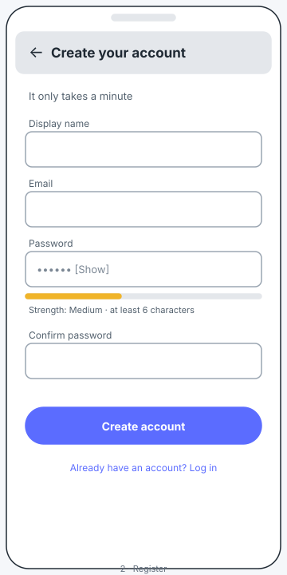 **2. Register**: name, email, password with strength hint, confirm password | 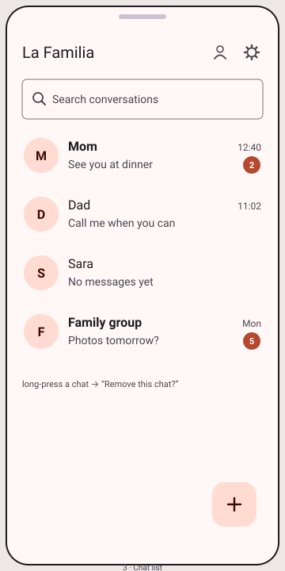 **3. Chat list**: search, conversations with last message, time and unread badge, + for a new chat |
| 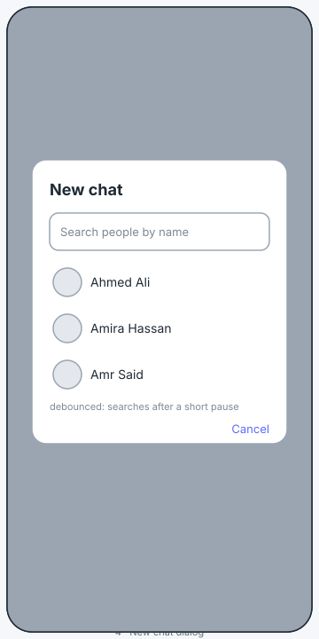 **4. New chat**: debounced search for people by name | 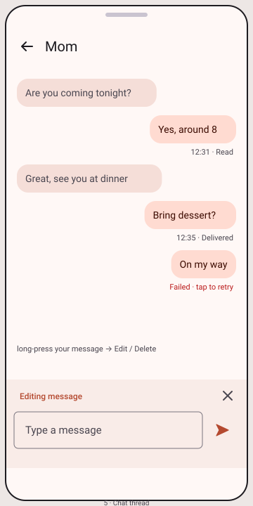 **5. Chat thread**: bubbles with status, retry on failure, edit and delete own messages | 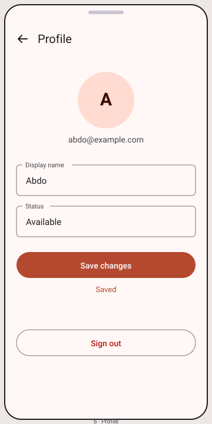 **6. Profile**: display name, status, save, sign out |
| 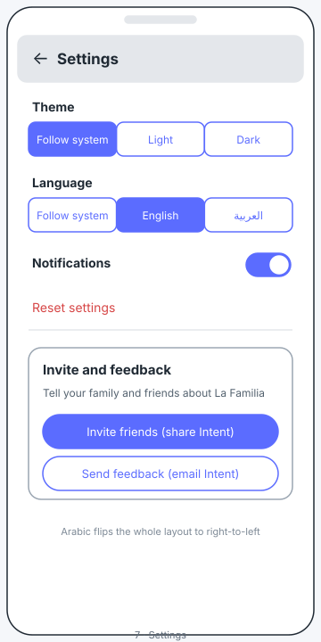 **7. Settings**: theme, language (Arabic switches to right-to-left), notifications, reset, invite and feedback Intents | | |

## Dark theme

The same screens with the dark theme (Settings → Theme → Dark, or "Follow system"
when the phone is in dark mode). Layout is identical; the colors switch to the
dark palette from `Color.kt`.

| | | |
|---|---|---|
| 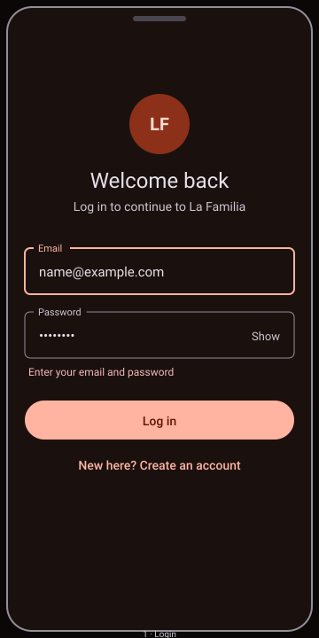 **1. Login** | 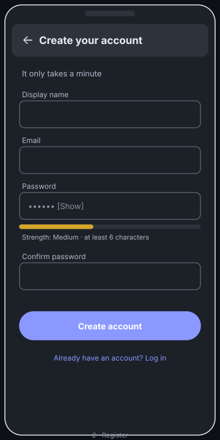 **2. Register** | 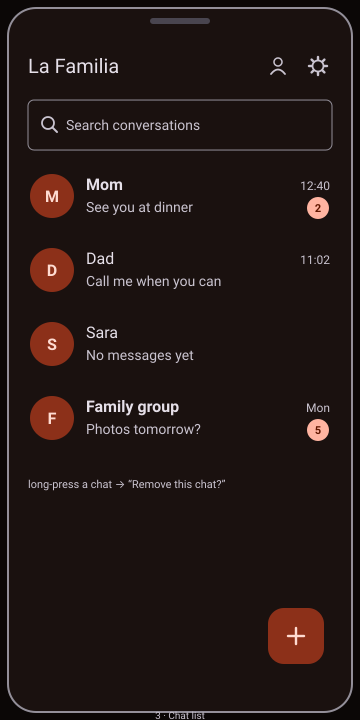 **3. Chat list** |
| 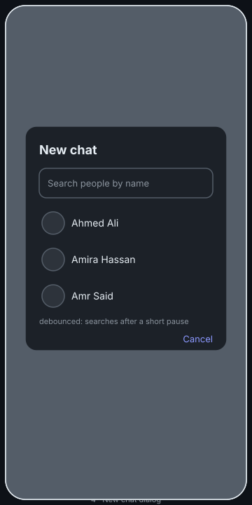 **4. New chat** | 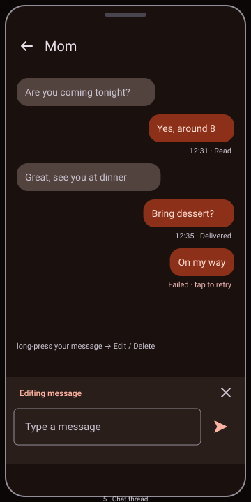 **5. Chat thread** | 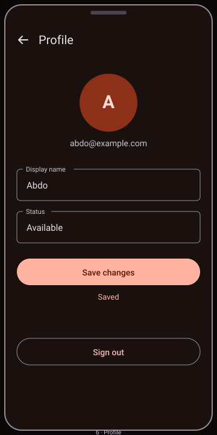 **6. Profile** |
| 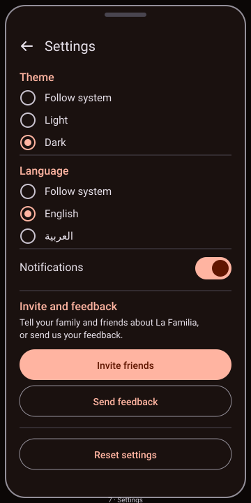 **7. Settings** | | |

The SVGs are generated, so they stay easy to update: edit the text or layout and
open the file in any browser to check it.
